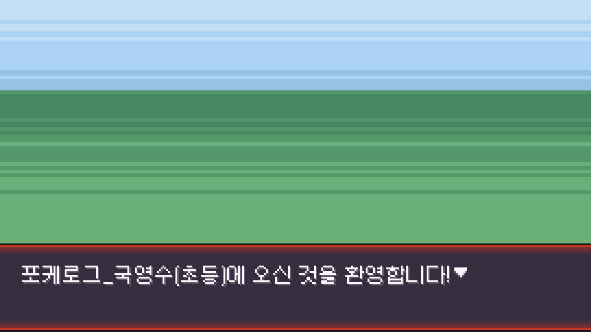
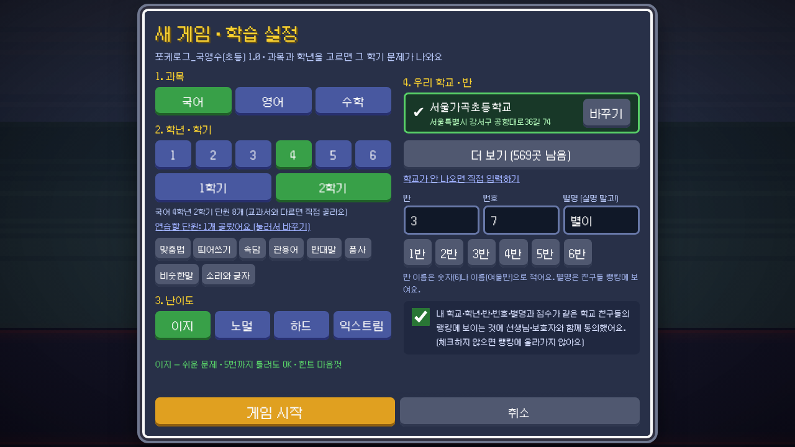
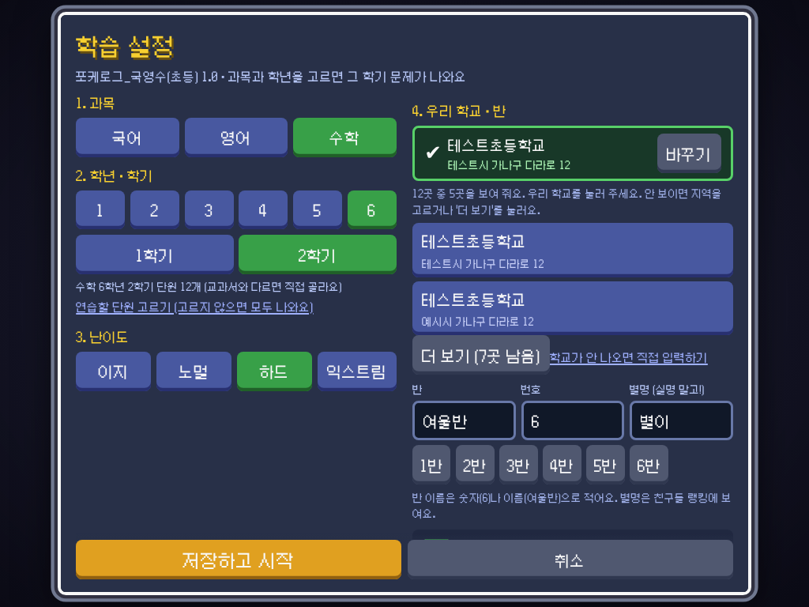
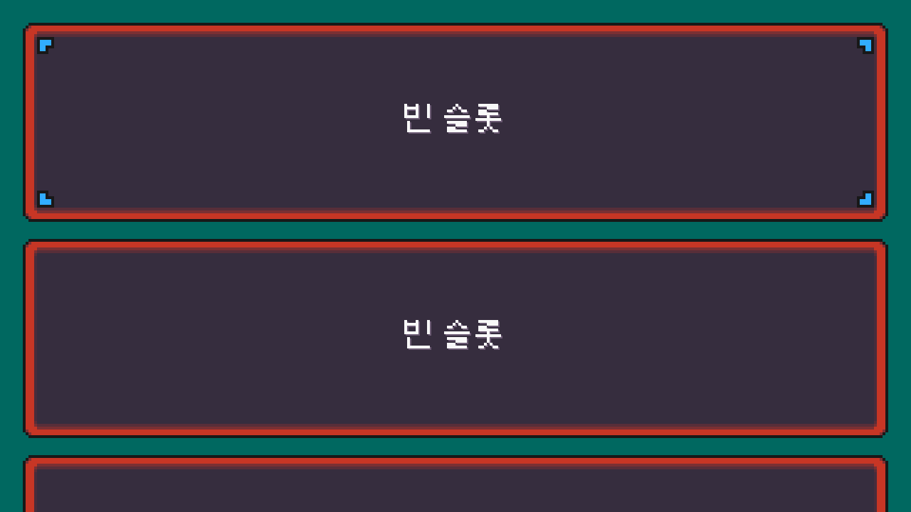
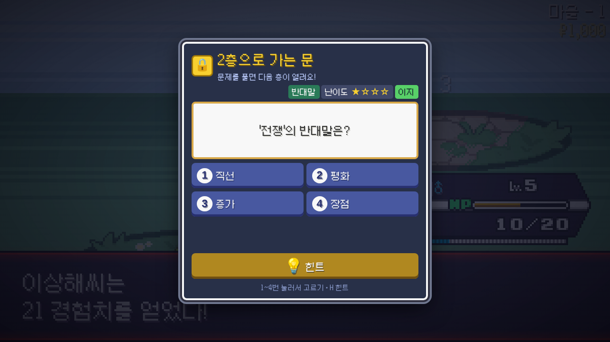
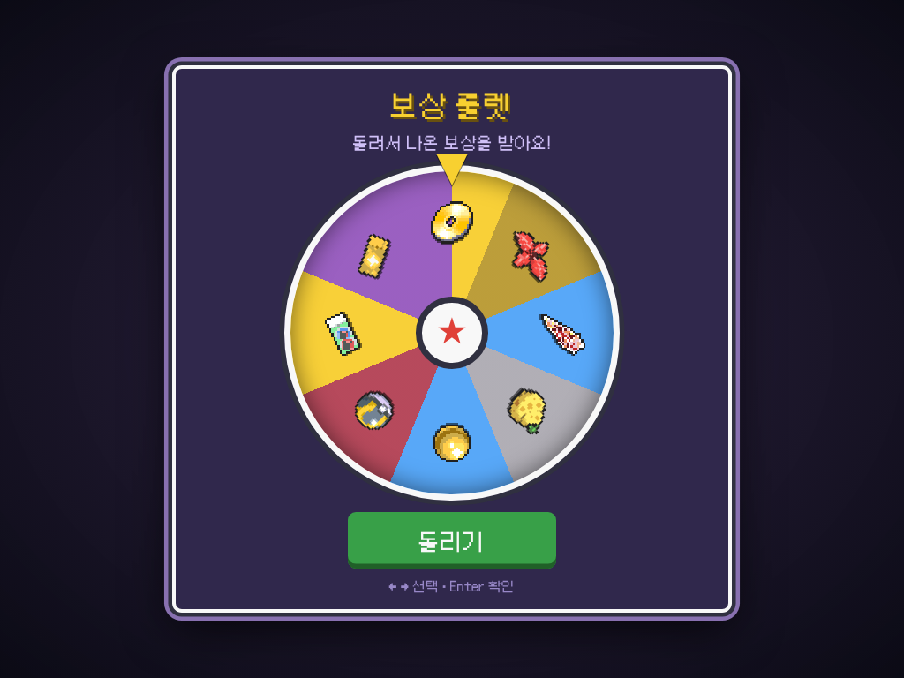
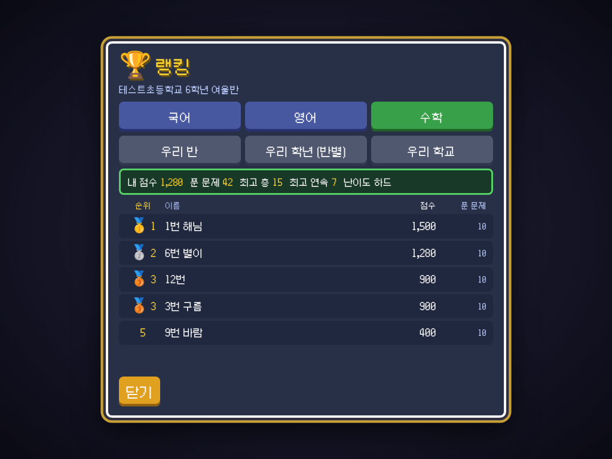

<div align="center">

# 🎮 포케로그_국영수(초등) 1.0

### 포켓몬을 키우며 **국어 · 영어 · 수학**을 풀어 다음 층으로 올라가는 학습 로그라이크

[](https://choivoo.github.io/pokerogue-edu/)
[](LICENSE)
[](https://github.com/pagefaultgames/pokerogue)
[](#-학습-설정)



</div>

> 원본 **PokéRogue(포케로그)** 베타 소스를 바탕으로, 층과 층 사이에 **문제 관문**을 넣은 학습용 버전입니다.
> 포켓몬·기술·아이템·바이옴·트레이너·이상한 만남 등 **게임 시스템은 그대로** 두었고, 게임 모드는 **클래식 하나**입니다.

---

## 📚 목차

- [한눈에 보기](#-한눈에-보기)
- [스크린샷](#-스크린샷)
- [게임 흐름](#게임-흐름)
- [학습 설정](#학습-설정)
- [문제](#문제)
- [정답 보상 (735종)](#정답-보상-735종)
- [회원가입 · 로그인 · 기기 사이 동기화](#회원가입--로그인--기기-사이-동기화)
- [랭킹과 학교 연동](#-랭킹과-학교-연동)
- [서버 연결하기](#서버-연결하기-한-번만--아이패드로-따라-하는-자세한-안내)
- [선생님을 위한 안내](#-선생님을-위한-안내)
- [자주 묻는 질문 (FAQ)](#-자주-묻는-질문-faq)
- [문제 해결 (트러블슈팅)](#-문제-해결-트러블슈팅)
- [개인정보](#개인정보)
- [GitHub Pages 배포](#github-pages-배포)
- [로컬에서 실행](#로컬에서-실행)
- [테스트](#테스트)
- [로드맵](#-로드맵)
- [기여하기](#-기여하기)
- [바뀐 파일](#바뀐-파일)
- [크레딧 · 라이선스](#-크레딧--라이선스)

---

## ✨ 한눈에 보기

| | |
| --- | --- |
| 🧭 **장르** | 로그라이크 (한 번 시작하면 세이브로 이어가는 탐험) + 학습 퀴즈 |
| 👦 **대상** | 초등학생 (학년·학기에 맞춘 문제) · 선생님 · 보호자 |
| 📖 **과목** | 국어 (17유형) · 영어 (단어 276 · 문장 58) · 수학 (75생성기 + 비례식·비례배분 20유형) |
| 🎚️ **난이도** | 이지 · 노멀 · 하드 · 익스트림 (4단계) |
| 🎁 **보상** | 735종 (기술머신, 진화 아이템, 민트, 몬스터볼, 테라피스, 포켓몬 등) |
| 🏫 **학교 연동** | 교육부 NEIS 학교 검색 → 학교 · 학년 · 반 · 번호로 랭킹 |
| ☁️ **계정** | 원본의 회원가입 · 로그인 그대로, 서버를 연결하면 **어느 기기에서든 같은 계정** |
| 📱 **기기** | PC · 태블릿(아이패드) · 휴대폰 브라우저 (설치 필요 없음) |
| 💸 **비용** | 무료 (GitHub Pages + Supabase 무료 요금제) |

---

## 🖼️ 스크린샷

<table>
<tr>
<td align="center" width="50%"><br/><sub><b>학습 설정</b> · 과목 · 학년 · 학기 · 반 · 난이도 · 단원</sub></td>
<td align="center" width="50%"><br/><sub><b>학교 검색</b> · NEIS 학교 정보로 찾기</sub></td>
</tr>
<tr>
<td align="center" width="50%"><br/><sub><b>전투</b> · 원본 포케로그 전투 그대로</sub></td>
<td align="center" width="50%"><br/><sub><b>문제 관문</b> · 맞히면 다음 층이 열려요</sub></td>
</tr>
<tr>
<td align="center" width="50%"><br/><sub><b>보상 룰렛</b> · 룰렛 · 보물 상자 · 보상 고르기</sub></td>
<td align="center" width="50%"><br/><sub><b>랭킹</b> · 우리 반 · 우리 학년 · 우리 학교</sub></td>
</tr>
</table>

---

## 게임 흐름

```
회원가입 / 로그인 (원본 화면 그대로)
      ↓
새 게임 → 📚 학습 설정 (과목 · 학년 · 학기 · 난이도 · 학교 · 반 · 번호)
      ↓
포켓몬 전투 승리 (또는 포획 · 도주)
      ↓
🔒 문제 관문 — 내 학년·학기 문제를 풀어야 다음 층이 열림
      ↓
🎁 보상 — 룰렛 / 보물 상자 / 보상 고르기 (735종)
      ↓
🔓 다음 층 개방 → 원래 아이템 선택 → 다음 포켓몬과 전투 → …
      ↓
🏆 점수가 반 · 학교 랭킹에 올라감
```

## 학습 설정

새 게임을 시작할 때와 메뉴의 **학습 설정**에서 바꿀 수 있습니다.

| 항목 | 내용 |
| --- | --- |
| 과목 | 국어 · 영어 · 수학 |
| 학년 · 학기 | 1학년 1학기 ~ 6학년 2학기 (12단계). 그 학기 단원 문제가 80%, 한두 학기 전 복습 문제가 20% |
| 난이도 | 이지 · 노멀 · 하드 · 익스트림 |
| 학교 | 교육부 NEIS 학교 검색으로 찾기 (안 되면 이름 직접 입력) |
| 반 | 숫자(`1`~`6`) 또는 이름(`여울반`, `새암반` …) |
| 번호 · 별명 | 번호 1~60, 별명은 선택 (실명 말고 별명!) |
| 연습할 단원 | 우리 반 교과서와 단원 구성이 다르면 그 학기 단원 중에서 연습할 단원만 골라요 (고르지 않으면 전체) |
| 랭킹 동의 | 학교·반·번호·별명·점수가 랭킹에 보이는 것에 선생님·보호자와 함께 동의해야 점수가 올라가요 |

### 난이도

| 난이도 | 문제 수준 | 오답 | 힌트 | 제한 시간 | 점수 | 보상 운 |
| --- | --- | --- | --- | --- | --- | --- |
| 이지 | 한 단계 쉬움 | 5번까지 | 마음껏 | 없음 | ×1 | +0 |
| 노멀 | 기본 | 3번까지 | 가능 | 없음 | ×1.5 | +0.2 |
| 하드 | 한 단계 어려움 | 2번까지 | 문제당 1번 | 60초 | ×2 | +0.6 |
| 익스트림 | 두 단계 어려움 | 1번만 | 없음 | 30초 | ×3 | +1.2 |

- 오답 횟수를 넘으면 **풀이를 보여주고 새 문제**로 바뀝니다. (HP가 줄거나 게임오버가 되지는 않아요)
- 시간이 다 되면 오답 1번으로 셉니다.
- 층이 올라갈수록 문제 수준도 올라갑니다 (1~9층 ★ → 10~29층 ★★ → 30~69층 ★★★ → 70층~ ★★★★).

## 문제

문제는 숫자를 직접 입력하는 **입력형**과 번호를 고르는 **4지선다**가 있고, 키보드(숫자·Enter·H)·마우스·터치로 풀 수 있습니다.

### 수학 (학기별 단원 · 생성기 75종 + 비례식·비례배분 20유형)
1학년: 9까지의 수, 덧셈·뺄셈, 100까지의 수, 시계 / 2학년: 세 자리 수, 받아올림·내림, 곱셈구구, 길이·시간 / 3학년: 나눗셈, 곱셈, 분수, 원, 들이·무게 / 4학년: 큰 수, 각도, 규칙 찾기, 분수·소수의 덧셈, 다각형, 막대그래프 / 5학년: 약수와 배수, 약분·통분, 규칙과 대응, 다각형의 넓이, 수의 범위, 어림하기, 분수·소수의 곱셈, 평균, 직육면체 / 6학년: 분수·소수의 나눗셈, 비와 비율, 각기둥, 겉넓이, **비례식과 비례배분(20유형)**, 원의 넓이, 원기둥, 쌓기나무

### 영어 (단어 276개 + 문장 58개)
알파벳, 단어 뜻 고르기, 우리말을 영어로, 빠진 알파벳 채우기, 다른 하나 고르기, 문장 빈칸(be동사 · have · 의문사 · 전치사 · 복수형 · 현재진행 · 과거 · 미래 · 비교급 · to부정사 · 대화)

### 국어 (유형 17종)
자음·모음 글자 만들기, 가나다 순서, 글자 수, 받침, 문장 부호, 반대말, 비슷한말, 높임말, 세는 말, 맞춤법, 띄어쓰기, 소리 나는 대로, 속담, 관용어, 사자성어, 품사

> 단원 구성은 교과서마다 조금 다를 수 있어서 **참고용**입니다. 문제는 프로그램이 계산해서 만들거나 확인한 자료로만 구성했고, 모든 정답은 테스트로 검증합니다.

## 정답 보상 (735종)

| 조건 | 보상 기회 |
| --- | --- |
| 정답 | 1번 |
| 힌트 없이 한 번에 정답 | +1번 |
| 연속 정답 5번마다 | + 잭팟 룰렛 (울트라 등급 이상만) |

보상 기회마다 **보상 룰렛(8칸) · 보물 상자(3개 중 1개) · 보상 고르기(3장 중 1장)** 중 하나가 무작위로 열립니다.
보상은 원본 게임 아이템 데이터로 만들며(기술머신 322 · 폼체인지 158 · 일반 71 · 진화 44 · 민트 25 · 몬스터볼 25 · 테라피스 19 · 타입강화 18 · 아이템 선택 찬스 12 · 나무열매 11 · 돈 8 · 룰렛권 4 …),
지금 파티가 쓸 수 없는 것은 나오지 않습니다. 난이도가 높고 연속 정답이 길수록 좋은 등급이 잘 나옵니다.

## 회원가입 · 로그인 · 기기 사이 동기화

원본 포케로그의 **회원가입 · 로그인 · 로그아웃 · 비밀번호 변경 · 세이브 불러오기/이어하기** 화면과 흐름이 그대로 동작합니다.
Discord/Google 로그인, 커뮤니티 메뉴 등 **외부로 나가는 링크는 숨겼습니다.**

계정을 어디에 저장하느냐는 서버 연결 여부로 정해집니다.

| | 서버(Supabase) 연결 **안 함** | 서버(Supabase) 연결 **함** (권장) |
| --- | --- | --- |
| 계정 · 세이브 | 이 브라우저(IndexedDB)에만 | **서버에 저장 → 어느 기기에서든 같은 계정** |
| 학습 설정 · 점수 | 이 브라우저에만 | 계정에 저장돼서 다른 기기에서도 그대로 |
| 랭킹 | 내 기록만 | 같은 반 · 학년 · 학교 친구들과 순위 비교 |

- 서버 모드에서는 비밀번호를 **bcrypt 로 암호화**해서 저장하고(서버도 원래 비밀번호를 모릅니다), 로그인하면 30일짜리 임시 열쇠를 받습니다. 비밀번호를 5번 틀리면 10분 동안 잠깁니다.
- 계정·세이브 테이블은 인터넷에서 직접 읽을 수 없고, 서버 함수(`edu_*`)로만 다룹니다. (`supabase/schema.sql`)
- 아이디: 한글·영문·숫자·`_`·`-` 2~16자, 비밀번호: 6자 이상.
- 인터넷이 잠깐 끊겨서 못 올린 점수는 기기에 보관했다가 연결되면 자동으로 올립니다.
- 서버를 연결하기 **전에** 이 브라우저에서 만든 계정은 **같은 아이디·비밀번호로 로그인하면 자동으로 서버로 옮겨집니다**(계정과 세이브). 연결 전의 점수만 랭킹에 올라가지 않습니다.

## 🏆 랭킹과 학교 연동

- **우리 반**(같은 학교 · 학년 · 반 학생들), **우리 학년(반별 합계)**, **우리 학교**(학생 전체) 순위를 과목별로 봅니다.
  순위표에는 `번호 + 별명`만 나옵니다. (실명은 받지 않습니다)
- 점수 = 문제 수준 × 10 + 한 번에 정답 5 + 연속 정답(최대 20), 거기에 난이도 배율. 문제를 풀 때마다 올라갑니다.
- 학교는 교육부 **NEIS 교육정보 개방 포털** 학교기본정보 API 로 찾고(초등학교만), 같은 이름은 지역·주소로 구분합니다.
  실제 서버로 확인한 대로 **인증키가 없으면 한 번에 5개씩** 주기 때문에, 지역(17개 시도)을 고르거나 **더 보기**로 이어서 받아요.
  인증키(`NEIS_KEY` 변수, 선택)를 넣으면 한 번에 많이 받습니다. 개교 전 학교(코드가 비어 있음)는 건너뜁니다.
  검색이 안 되면 학교 이름을 직접 입력할 수 있습니다. (이 경우 공백이 달라도 같은 이름을 적은 친구들끼리 한 학교로 묶여요)
- **랭킹에 동의한 계정만** 점수가 올라갑니다. (학습 설정의 동의 체크)

### 점수 조작 막기

점수는 반드시 **로그인한 본인이 서버 함수로만** 올릴 수 있고, 서버가 다음을 막습니다.
로그인하지 않은 요청 · 랭킹 동의가 없는 계정 · 한 번에 250점 초과 · 3초 안의 연속 요청 · **한 시간에 3만 점 초과** · 점수가 줄어드는 갱신.
(완벽한 방지는 아니에요. 마음먹고 프로그램으로 계속 보내면 천천히 올릴 수는 있으니, 같은 반 친구끼리 즐기는 용도로 쓰세요.)

### 서버 연결하기 (한 번만) — 아이패드로 따라 하는 [자세한 안내](docs/서버-연결-아이패드.md)

1. <https://supabase.com> 에서 무료 프로젝트를 만듭니다. (Region 은 Northeast Asia (Seoul) 를 추천)
2. 왼쪽 **SQL Editor → New query** 에 [`supabase/schema.sql`](supabase/schema.sql) 내용을 전부 붙여 넣고 **Run** 을 누릅니다.
3. **Project Settings → API** 에서 `Project URL` 과 `anon public` 키를 복사합니다.
4. 이 저장소 **Settings → Secrets and variables → Actions → Variables** 탭에서 변수 두 개를 만듭니다.
   - `SUPABASE_URL` = Project URL (`https://….supabase.co`)
   - `SUPABASE_ANON_KEY` = anon public 키 (공개되어도 되는 키입니다. `service_role` 키는 **절대 넣지 마세요**)
5. **Actions 탭 → 배포 워크플로 → Run workflow** 로 다시 배포하면 서버가 켜집니다.

최근 Supabase 는 `anon` 키 대신 `sb_publishable_…` 공개 키도 줍니다. 둘 다 쓸 수 있고, 비밀 키(`service_role`, `sb_secret_…`)는 게임이 알아보고 거부합니다.

서버가 연결되었는지는 새로 가입한 뒤 Supabase 의 **Table Editor → edu_users** 에 계정이 생겼는지 보면 됩니다.

## 개인정보

수집하는 정보: 학교 이름, 학년, 반, 번호, 별명, 점수(그리고 게임 세이브). **실명·연락처·사진은 받지 않습니다.**
어린이가 쓰는 서비스라서 별명에 실명을 쓰지 않도록 안내하고, 랭킹은 **동의 체크를 한 계정만** 올라갑니다.
학교에서 쓸 때는 선생님과 보호자의 동의를 받아 주세요.
서버를 연결하지 않으면 모든 정보가 그 기기(브라우저) 안에만 있습니다.

## GitHub Pages 배포

`.github/workflows/deploy-pages.yml` 이 들어 있어서 `main` 브랜치에 푸시하면 자동으로 배포됩니다.

1. 저장소 **Settings → Pages → Build and deployment → Source** 를 **GitHub Actions** 로 바꿉니다.
2. 작업 브랜치를 `main` 에 병합(또는 Actions 탭에서 수동 실행)합니다.
3. 몇 분 뒤 `https://<사용자명>.github.io/<저장소명>/` 에서 플레이할 수 있습니다.

배포 빌드는 **브라우저 계정 서버 모드**(`.env.pages`)로 만들어지고, 원본 에셋(이미지·사운드 약 830MB)과 번역 파일이 함께 올라갑니다.

## 로컬에서 실행

```bash
git clone --recurse-submodules <이 저장소 주소>
cd Pokemon-Entry
# 이미 클론했다면: git submodule update --init --recursive
pnpm install
pnpm start:pages     # 배포와 같은 설정의 개발 서버 (http://localhost:8000)
pnpm build:pages     # 배포용 빌드 → dist/
```

서버(Supabase) 없이 계정 동기화까지 시험해 보려면, 내 컴퓨터의 PostgreSQL 에 `supabase/schema.sql` 을 적용하고
`node scripts/dev/rpc-bridge.mjs` 를 켠 다음 `VITE_SUPABASE_URL=http://localhost:8788 VITE_SUPABASE_ANON_KEY=<40글자 이상 아무 글자>` 로 실행하면 됩니다.

## 테스트

```bash
pnpm vitest run test/edu test/math   # 국영수 · 랭킹 · 계정 서버 테스트
psql -f supabase/schema.sql && psql -f test/edu/sql/schema-test.sql   # 서버 함수 검사 (PostgreSQL, 배포할 때 자동 실행)
pnpm test                            # 원본 게임 테스트 전체
```

- 문제 생성기는 학기·과목·수준마다 수천 개를 뽑아서 형식·정답·중복·글자를 검사하고, 수학은 계산식을 따로 다시 계산해서 비교합니다.
- 원본 게임의 자동화 테스트에서는 문제 관문이 기본으로 꺼져 있습니다. 테스트에서 켜려면 `game.override.mathGate(true)` 를 씁니다.

## 바뀐 파일

| 파일 | 내용 |
| --- | --- |
| `src/edu/question.ts`, `difficulty.ts` | 공통 문제 형식, 난이도 4단계 규칙, 점수 |
| `src/edu/math-curriculum.ts` | 수학 생성기 (1-1 ~ 6-2) |
| `src/edu/bank-english.ts`, `bank-korean.ts` | 영어 · 국어 문제 자료와 생성기 |
| `src/edu/select.ts` | 과목·학년·학기·난이도에 맞는 문제 뽑기 |
| `src/edu/profile.ts`, `stats.ts` | 학습자 프로필(학교·반·번호), 내 기록 |
| `src/edu/neis.ts` | 학교 검색 (NEIS) |
| `src/edu/backend.ts`, `sync.ts` | 서버 연결, 기기 사이 동기화(학습 설정 · 점수) |
| `src/edu/ranking.ts`, `ranking-ui.ts` | 점수 올리기(대기열 포함)와 순위표 화면 |
| `supabase/schema.sql` | 서버(Supabase) 테이블과 함수: 계정 · 세이브 · 랭킹 · 점수 조작 방지 |
| `scripts/dev/rpc-bridge.mjs` | 개발용: 내 컴퓨터의 PostgreSQL 로 서버 요청 전달 |
| `src/edu/setup-ui.ts`, `ui-kit.ts` | 학습 설정 화면 |
| `src/math/*` | 비례식·비례배분 20유형, 관문 화면(입력형·선택형·제한 시간), 보상 목록 735종과 보상 화면 |
| `src/phases/math-gate-phase.ts`, `math-reward-phase.ts` | 관문·보상 단계 |
| `src/phases/title-phase.ts` | 새 게임을 클래식 전용으로, 시작 전에 학습 설정 |
| `src/ui/handlers/menu-ui-handler.ts` | 메뉴에 학습 설정 · 랭킹 추가, 외부 커뮤니티 링크 제거 |
| `src/tutorial.ts`, `index.html` | 처음 접속 안내(외부 주소 제거), 제목 |
| `src/api/local-server.ts`, `remote-server.ts` | 브라우저 계정 서버 / 서버(Supabase) 계정 서버 |
| `.env.pages`, `scripts/pages/*`, `.github/workflows/deploy-pages.yml` | GitHub Pages 배포 |
| `test/edu/*`, `test/math/*`, `test/edu/sql/*` | 테스트 (서버 함수 검사 SQL 포함) |

## 👩‍🏫 선생님을 위한 안내

- **수업에서 쓰는 방법**: 학생이 각자 자기 기기에서 학습 설정(과목 · 학년 · 학기 · 반 · 번호)을 고르고 플레이합니다.
  수업 중에는 **한 과목(예: 6학년 2학기 수학)** 을 정해 주고, 단원도 수업 진도에 맞춰 고르게 하면 효과가 좋아요.
- **랭킹 동의**: 랭킹에 올라가려면 학생과 보호자의 동의가 필요합니다. 동의하지 않은 계정은 점수가 올라가지 않아요.
- **별명 지도**: 순위표에는 **번호 + 별명**만 보입니다. 실명을 별명으로 쓰지 않도록 미리 안내해 주세요.
- **학교 찾기가 안 될 때**: 지역을 고른 뒤 **더 보기**를 누르거나, 학교 이름을 직접 적어도 됩니다.
- **계정 관리**: 서버를 연결했다면 Supabase 의 `edu_users` 표에서 계정 수를 볼 수 있어요. 비밀번호는 암호화되어 있어 선생님도 볼 수 없습니다.
- **난이도 추천**
  - 처음 시작하는 학생: **이지** (힌트 무제한, 제한 시간 없음)
  - 학기 단원을 익힌 학생: **노멀**
  - 도전하는 학생: **하드** (제한 시간 60초)
  - 상위 도전: **익스트림** (오답 1번이면 풀이로 넘어감, 제한 시간 30초)

---

## ❓ 자주 묻는 질문 (FAQ)

**Q. 설치해야 하나요?**
아니요. 주소를 열면 바로 플레이할 수 있어요. 아이패드 Safari 나 크롬 브라우저면 충분합니다.

**Q. 문제가 틀리면 게임오버가 되나요?**
아니요. 오답 횟수를 넘기면 풀이를 보여 주고 새 문제로 바뀝니다. HP 는 줄지 않아요.

**Q. 세이브는 어디에 저장되나요?**
서버를 연결하지 않으면 **그 브라우저 안에만** 저장됩니다. 서버를 연결하면 계정에 저장돼서 다른 기기에서도 이어 할 수 있어요.

**Q. 브라우저 데이터를 지우면 어떻게 되나요?**
서버 연결 없이 쓰던 경우 **세이브가 사라집니다.** 서버를 연결해 두면 로그인만 하면 다시 돌아와요.

**Q. 아이패드(Safari)에서 세이브가 사라져요.**
Safari 는 7일 동안 방문하지 않은 사이트의 저장 공간을 지울 수 있어요. 서버를 연결하면 이 문제가 없습니다.

**Q. 랭킹에 왜 안 올라가요?**
다음을 확인해 주세요: ① 랭킹 동의를 체크했는지 ② 서버가 연결되어 있는지(`?diag` 점검) ③ 학교 · 반이 정해졌는지.
그래도 안 되면 [문제 해결](#-문제-해결-트러블슈팅)을 보세요.

**Q. 같은 문제가 자꾸 나와요.**
문제는 학기 단원 안에서 무작위로 나오고, 같은 유형이 연속으로 나오지 않게 되어 있어요. 단원을 여러 개 고르면 더 다양하게 나옵니다.

**Q. 원본 포케로그와 무엇이 다른가요?**
- 층 사이에 **문제 관문**이 생깁니다. 내가 고른 과목 · 학년 · 학기 · 난이도 문제를 풀어야 다음 층이 열려요.
- 정답 보상(룰렛 · 보물 상자 · 보상 고르기)과 **학교 · 반 랭킹**이 추가되었어요.
- 게임 모드는 **클래식만** 있어요. (다른 모드는 제거)
- 외부 커뮤니티 · Discord · Google 로그인 링크는 **숨겼어요.**

**Q. 점수 조작은 막혀 있나요?**
서버가 한 번에 올릴 수 있는 점수, 올리는 간격, 한 시간 상한을 제한합니다. 완벽하지는 않으니 같은 반 친구끼리 즐기는 용도로 써 주세요.

---

## 🔧 문제 해결 (트러블슈팅)

| 증상 | 원인 | 해결 |
| --- | --- | --- |
| "서버에 연결하지 못했어요" 창이 떠요 | 서버 주소나 키가 사이트에 안 들어갔거나 Supabase 가 멈춤 | 주소 끝에 **`?diag`** 를 붙여 점검 화면을 열어 보세요. 빨간 ✘ 줄에 해결 방법이 나와요 |
| 등록할 때 "서버 연결 문제" 가 나와요 | 위와 같음 | 같은 방법으로 점검 |
| 로그인이 안 돼요 (아이디 · 비밀번호 확인) | 서버에 없는 계정이거나 비밀번호가 다름 | 비밀번호 6자 이상 · 대소문자 확인. 서버 연결 전에 만든 계정이면 같은 정보로 다시 로그인 |
| 학교 검색 결과가 없어요 | NEIS 응답이 적거나 지역이 틀림 | 지역을 바꾸거나 **더 보기**, 안 되면 학교 이름 직접 입력 |
| 바뀐 내용이 사이트에 안 보여요 | 배포가 끝나지 않았거나 브라우저 캐시 | 몇 분 뒤 새로고침, 그래도 안 되면 사이트 데이터 삭제 후 다시 열기 |
| 소리가 안 나요 | 브라우저가 자동 재생을 막음 | 화면을 한 번 터치하거나 클릭 |
| 아이패드에서 화면이 잘려요 | 가로 · 세로 전환 직후 | 기기를 한 번 돌렸다가 다시 놓기 |

`?diag` 점검 화면은 아래 순서로 확인해요.
1. **서버 주소** — `https://….supabase.co` 모양인지
2. **키** — 공개 키(anon 또는 `sb_publishable_…`)인지. 비밀 키가 보이면 **즉시 폐기**하세요.
3. **서버 함수** — `edu_player_count` 가 응답하는지
4. **순위표 읽기** — `scores` 표를 읽을 수 있는지

---

## 🗺️ 로드맵

- [x] 원본 포케로그 베이스 + 클래식 전용 모드
- [x] 과목 · 학년 · 학기 · 난이도 · 단원 선택 설정
- [x] 문제 관문 (입력형 · 4지선다 · 제한 시간 · 힌트 · 풀이)
- [x] 정답 보상 735종 (룰렛 · 보물 상자 · 보상 고르기 · 잭팟 룰렛)
- [x] NEIS 학교 검색, 학교 · 학년 · 반 · 번호 랭킹
- [x] 서버 계정 (회원가입 · 로그인 · 기기 사이 동기화)
- [x] 점수 조작 방지 (서버 함수 기반)
- [x] 아이패드 화면 대응, `?diag` 서버 점검 화면
- [ ] 선생님용 학급 관리 화면 (반 학생 목록 · 진도 확인)
- [ ] 과목별 학습 리포트 (맞힌 단원 · 틀린 단원 그래프)
- [ ] 문제 추가 편집 도구 (선생님이 직접 문제 추가)
- [ ] 영어 듣기 문제 (음성 파일 추가)
- [ ] 한국어 · 영어 UI 전환

---

## 🤝 기여하기

1. 이슈로 문제 · 아이디어를 먼저 알려 주세요. (학교에서 쓰면서 생긴 불편은 특히 환영해요)
2. 작업 브랜치를 만들고 변경 사항을 커밋하세요.
3. `pnpm vitest run test/edu test/math` 가 통과하는지 확인하세요.
4. `main` 으로 Pull Request 를 보내 주세요.

**문제 추가 규칙**
- 정답은 프로그램이 계산해서 확인해야 해요. 손으로 쓴 정답만으로 넣지 마세요.
- 초등 교육과정 학기와 단원 이름을 맞춰 주세요.
- 한 문제는 **유형 이름(kind)** 을 가져야 같은 유형이 연속으로 나오지 않아요.

---

## 🙏 크레딧 · 라이선스

- **원본 게임**: [PokéRogue](https://github.com/pagefaultgames/pokerogue) — Pagefault Games 가 만든 오픈소스 게임입니다. 게임 에셋과 시스템은 원작자의 작업을 그대로 사용했어요.
- **포켓몬**: Nintendo · Creatures Inc. · GAME FREAK inc. 의 상표입니다.
- **학교 정보**: 교육부 NEIS 교육정보 개방 포털의 학교기본정보 API.
- **서버**: Supabase (PostgreSQL). 배포는 GitHub Pages.
- **학습 콘텐츠**: 단원 구성은 교과서를 참고했으며, 문제는 프로그램이 만들고 검사한 자료입니다.

## 라이선스

원본 PokéRogue 와 같은 AGPL-3.0 라이선스를 따릅니다 (`LICENSE`, `LICENSES/` 참고).
포켓몬은 Nintendo / Creatures Inc. / GAME FREAK inc. 의 상표이며, 이 프로젝트는 비영리 팬 프로젝트입니다.
